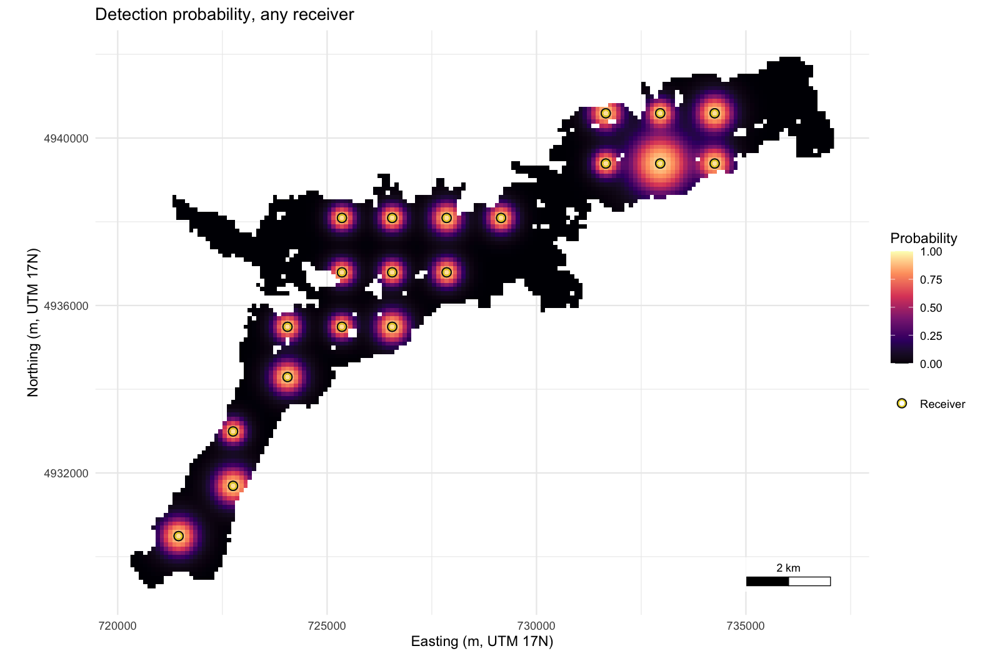

<!-- README.md is written from README.Rmd by tools/build_readme.R; edit README.Rmd. -->

# arraydesign 

[-blue.svg)](https://www.gnu.org/licenses/gpl-3.0)

**arraydesign** designs acoustic receiver arrays and tests the
performance of tracking systems on simulated animals, for a new study or
for refining or auditing an array already in the water. It takes a depth
raster of the water body, a range model and a set of receiver positions.
The range model is your own model fitted to your range-test data and
wrapped by `de_model()` of the
[**detfield**](https://jakebrownscombe.github.io/detfield/) R package,
or a stand-in curve from two distances made by
`detfield::de_logistic()`. It returns the share of the water the array
hears, how often simulated animals are detected, and how far positions
estimated from their detections fall from the true tracks.

## Install

``` r
# install.packages("remotes")
remotes::install_github(c("jakebrownscombe/detfield",
                          "jakebrownscombe/arraydesign"),
                        build_vignettes = TRUE, dependencies = TRUE)
```

To install all four positionR packages at once, see the
[**positionR**](https://jakebrownscombe.github.io/positionR/) landing
page.

## Example

Place 20 receivers on a grid over Stoney Lake, Ontario, the example data
included with the package, and map the probability that the array hears
a transmission from each water cell.

``` r
library(arraydesign)

# Read Stoney Lake: 100 m cells, depth zero or negative metres, land NA
lake <- terra::rast(system.file("extdata", "stoney_depth.tif",
                                package = "arraydesign"))

# Lay 20 receivers on a grid over water at least 1 m deep
deployable <- terra::ifel(abs(lake) < 1, NA, lake)
receivers <- place_receivers(deployable, n = 20, method = "grid", seed = 1)

# Set the range model: d50 and d05 at receivers 1 m and 35 m deep
range_model <- detfield::de_logistic(d50 = c(250, 750), d05 = c(500, 1500),
                                     depth = c(1, 35))

# Build the detection field through water
field <- detfield::de_field(detfield::water_distances(lake, receivers),
                            range_model)
#> 52 of 2,304 receiver-cell pairs with p >= 0.05 have land on the
#>   straight line between them; with blocked = 0 the curve is read on
#>   them as if the line were clear. See `blocked` in ?de_model.

# Map the probability that any receiver hears, per water cell. plot() draws
# the receivers without a key, so the same rings are drawn again with one
ring <- detfield::positionr_ring_colours()
plot(field) +
  ggplot2::geom_point(data = receivers, ggplot2::aes(shape = "Receiver"),
                      colour = ring[["edge"]], size = 2, stroke = 1.3) +
  ggplot2::geom_point(data = receivers, ggplot2::aes(shape = "Receiver"),
                      colour = ring[["heard"]], size = 2, stroke = 0.6) +
  ggplot2::scale_shape_manual(name = NULL, values = c(Receiver = 21))
```



*Probability that at least one of the 20 receivers hears one
transmission from each 100 m water cell of Stoney Lake.*

The message from `de_field()` counts the receiver and cell pairs with
`p >= 0.05` that have land on the straight line between them. A curve
from `de_logistic()` reads a pair with land on the line at the distance
through water; `blocked` in `?detfield::de_model` sets how much less
such pairs hear.

## Articles

- [Design and test an array for Stoney
  Lake](https://jakebrownscombe.github.io/arraydesign/articles/arraydesign.html),
  the Get started page, places the receivers, maps coverage, sets a
  movement model, simulates detections and scores the positions.
- [Design an array for your own water
  body](https://jakebrownscombe.github.io/arraydesign/articles/design-an-array.html)
  starts from your own raster, station lists and range model, scores
  candidate layouts side by side and writes a station sheet for the
  field crew.
- [Specifying and testing movement
  models](https://jakebrownscombe.github.io/arraydesign/articles/movement-models.html)
  sets a walk, a switch between moving and resting, and a start and goal
  for each animal.
- [Simulate and score an array step by
  step](https://jakebrownscombe.github.io/arraydesign/articles/simulate-detections.html)
  gives each stage of `evaluate_array()` as a table you can inspect or
  change.

## The suite

**arraydesign** is one of the four positionR packages, which share one
example lake, one range model and one set of column names, as the
diagram below shows.


- [positionR, the suite](https://jakebrownscombe.github.io/positionR/)
- [**detqc**](https://jakebrownscombe.github.io/detqc/): read, check and
  filter detections.
- [**detfield**](https://jakebrownscombe.github.io/detfield/): detection
  fields and positions.
- [**arraydesign**](https://jakebrownscombe.github.io/arraydesign/):
  design and test the performance of tracking systems.
- [**arraydesignR**](https://jakebrownscombe.github.io/arraydesignR/):
  **arraydesign** as a point-and-click application.

## Cite

Brownscombe J (2026). *positionR: tools for acoustic telemetry studies*.
R package version 2.0.0, <https://jakebrownscombe.github.io/positionR/>.

Brownscombe J (2026). *arraydesign: Acoustic Receiver Array Design and
Track Simulation*. R package version 0.1.1,
<https://jakebrownscombe.github.io/arraydesign/>.

## How the code was written

The code and this documentation were written with an AI coding
assistant, Claude Code v2.1.145.

## Licence

GPL (\>= 3).
